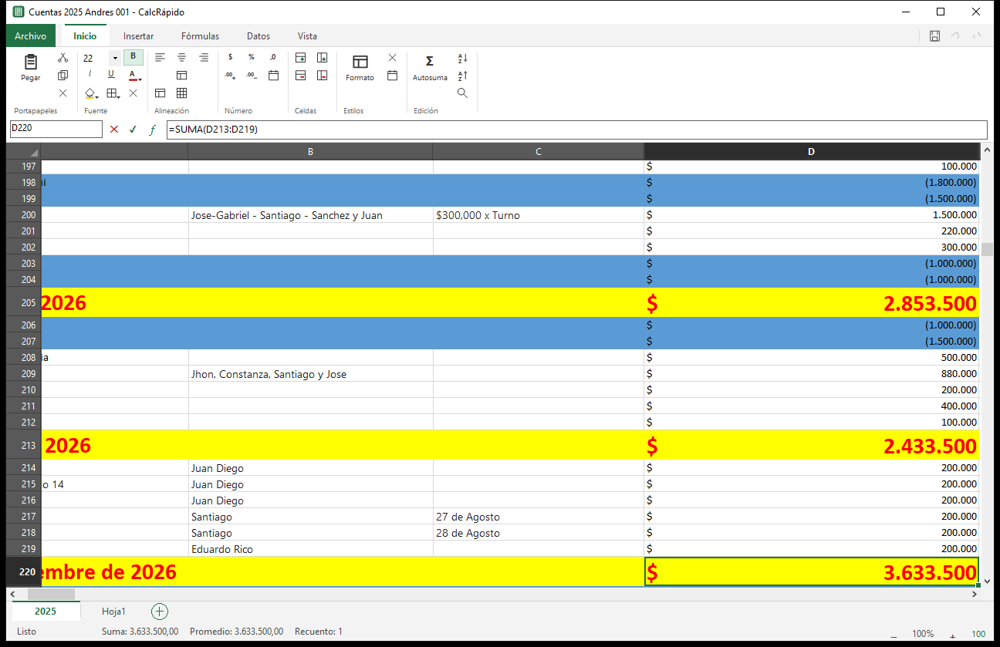

# Mini Excel

> **Mini Excel Beta 0.0.6**
> Seguridad de apertura: ver [SEGURIDAD.md](SEGURIDAD.md). — vista previa, no estable 1.0. Ver `PRUEBAS-COMPATIBILIDAD.md` para
> los límites de `.xls`, fórmulas compartidas, imágenes y objetos avanzados.

Hoja de cálculo nativa para Windows, pensada para **arrancar rápido y ocupar poco**, con una
interfaz y unos comandos deliberadamente parecidos a Excel. Forma parte de la idea **Mini Office**:
un programa de pocos cientos de KB que puede abrir, editar y guardar los `.xlsx` que envían otras
suites, sin arrastrar una instalación de varios cientos de MB.

- **Un solo ejecutable de 522 KB** (534.528 bytes), sin instalador, sin Electron y sin
  dependencias de terceros.
- **Arranque medido: 228–365 ms** según la caché del sistema; en caliente ronda los 230–240 ms
  (Windows 10 x64, .NET Framework 4.8).
- **Memoria en reposo: ~32 MB** de working set.
- **`.xlsx` es el formato principal de lectura y guardado.** También conserva el formato nativo
  `.crb` y exporta `.csv`.
- **Guardado atómico y recuperación:** cada guardado escribe primero un archivo temporal y
  solo sustituye el destino cuando termina correctamente. Además se crea una copia de
  recuperación periódica (por sesión, cifrada con DPAPI y EFS cuando está disponible) y al
  reiniciar se ofrece restaurarla tras un cierre inesperado.
- **Avisos al abrir**: si el documento trae funciones no soportadas, gráficos, imágenes,
  tablas, tablas dinámicas o macros, se muestra un aviso de compatibilidad y se explican
  los límites de esta versión.
- **Impresión y vista previa**: `Ctrl+P` abre opciones para imprimir la selección, la hoja
  activa, varias hojas o todo el libro; permite orientación, papel, márgenes, cuadrícula,
  encabezados, ajuste a una página o una página de ancho, encabezados/pies personalizados
  del documento y **vista previa desplazable con la rueda del mouse**. La selección se ajusta completa aunque incluya filas o
  columnas vacías fuera de los datos.
- **Tipos avanzados de gráfico:** histograma, cascada, embudo, mapa de árbol, sunburst, superficie, acciones y cajas se muestran con una representación compatible de columnas/líneas/área.
- **Pie of pie:** los gráficos de torta con desglose muestran la torta principal y la secundaria, incluida la porción «Otros».
- **Gráficos combinados:** barras/columnas y líneas en el mismo gráfico; los ejes secundarios se comparten por ahora.
- **Gráficos**: lee y muestra los tipos básicos de gráficos de Excel, los conserva al
  guardar y permite crear columnas, barras, líneas, áreas, circulares y dispersión.
  Los gráficos nuevos se escriben como ChartML editable en `.xlsx` y también se
  imprimen y se guardan en `.crb`. Un gráfico se puede seleccionar con el mouse,
  mover, redimensionar desde la esquina inferior derecha y eliminar con `Supr` o
  con el menú contextual. También se editan las series desde el menú contextual.
- **Paneles inmovilizados**: botones Inmovilizar/Movilizar en Vista; las filas y
  columnas superiores quedan fijas al desplazarse.
- **Datos**: autofiltro de hoja y **controles de filtro de tabla** en la fila de encabezado; autofiltro básico por columna y validación con listas desplegables
  (`F4` o `Alt+Abajo` para elegir un valor).
- **Imágenes**: se muestran, imprimen, mueven, recortan y eliminan; el formato
  nativo `.crb` las conserva.
- **Formato condicional avanzado**: escalas de color, barras de datos, conjuntos de
  iconos, reglas de valor, texto, fechas, duplicados y Top/Bottom.
- **Botones y formas enlazadas**: los botones con hipervínculo del dibujo se muestran y
  se pueden pulsar para navegar a la hoja o URL de destino.
- **OOXML strict**: se puede generar una copia strict desde Archivo; se probó su
  apertura en Excel.
- **Tablas editables:** al escribir en la fila/columna inmediatamente inferior o derecha, el rango de tabla se amplía y conserva su estilo.
- **Vínculos externos:** se detectan y se avisa de que se conservan sin actualizar.
- **Segmentadores funcionales:** al pulsar un elemento se filtra la tabla dinámica y se recalcula su resumen.
- **Tablas dinámicas con campos de columna:** se genera una matriz de filas × valores de columna.
- **Tablas dinámicas con varios campos de fila:** se respeta `firstDataCol` para decidir cuántos niveles de fila mostrar.
- **Tablas dinámicas actualizables:** el menú contextual reconstruye la tabla desde su caché (suma de campos de datos) y los segmentadores aplican un filtro básico. No implementa agrupaciones, campos calculados ni estilos avanzados de Excel.
- **Hojas protegidas:** se abren en modo de solo lectura y bloquean la edición.
- **Títulos de impresión:** se repiten filas y columnas de título en cada página.
 las filas configuradas como título se repiten en cada página.
- **Fórmulas dinámicas:** `SEQUENCE`, `FILTER`, `SORT`, `UNIQUE`, `LET`, `TAKE`,
  `DROP`, `HSTACK` y `VSTACK`, con derrame de resultados en celdas vecinas.
- **Funciones modernas**: `SUMIFS`, `COUNTIFS`, `AVERAGEIFS`, `MAXIFS`, `MINIFS`,
  `SUBTOTAL`, `TIME`, `TIMEVALUE`, `XLOOKUP`, `XMATCH`, `TEXTJOIN`, `SWITCH`,
  `DAYS`, `DATEDIF`, `NETWORKDAYS`, `WORKDAY`, `YEARFRAC`, `RANK.EQ`,
  `PERCENTILE.INC`, `QUARTILE.INC`, `CEILING.MATH`/`FLOOR.MATH`, `AGGREGATE`,
  `TEXTBEFORE` y `TEXTAFTER`.



## Inicio rápido

1. Ejecuta `MiniExcel.exe` (en este repositorio, `dist\MiniExcel.exe`). No requiere instalación.
2. Escribe en la celda activa y pulsa `Enter`, o utiliza la barra de fórmulas.
3. Prueba `=SUMA(A1:A10)`, `=PROMEDIO(B2:B8)`, `=SI(A1>0;"Sí";"No")`.
4. Abre `Ejemplo.xlsx`, que acompaña al ejecutable, para ver formato, moneda, fechas, una tabla,
   una imagen y un gráfico creados por otra suite.

También puedes abrir un archivo desde la línea de comandos:

```bat
MiniExcel.exe "C:\ruta\libro.xlsx"
```

## Rendimiento con libros grandes

Prueba realizada con 100.000 filas × 10 columnas (1.000.000 de celdas y
99.999 fórmulas):

```text
Carga:            8,8 s
Recalcular:       0,2 s
Guardar:          9,5 s
Recargar:        10,2 s
RAM tras cargar:  ~790 MB
```

La interfaz abre el mismo libro en ~9,2 s con ~825 MB de working set. Un libro
de 2.000.000 de celdas se rechaza con un error controlado por el límite de
512 MB de contenido descomprimido; no se cierra la aplicación.

Para libros de más de 500.000 celdas se recomienda tener al menos 2 GB de RAM
libre y guardar con frecuencia.

La recuperación automática se desactiva por encima de **300.000 celdas** para no
duplicar un libro grande en memoria. En ese caso la aplicación avisa y el usuario
debe guardar manualmente. Un fallo de la recuperación en segundo plano se muestra
en la barra de estado; no se descarta silenciosamente.

El hash PE del ejecutable puede variar entre compilaciones aunque el código y el
tamaño coincidan; para verificar una publicación use la versión de archivo, el
tamaño y el hash anunciado en el release.

## Compatibilidad XLSX (Nivel 2)

Mini Excel no vuelve a generar el libro desde cero cuando guarda un `.xlsx` abierto: **copia el
paquete original y parchea solo las partes que han cambiado** (hoja, libro, estilos, relaciones y
tipos de contenido). Así conserva lo que la aplicación no edita.

### Se lee, se muestra y se guarda

- Hojas, celdas, fórmulas, valores, estilos y anchos de columna.
- **Celdas combinadas**, con selección y edición sobre el rango combinado.
- **Altos de fila**, filas ocultas y columnas ocultas.
- **Paneles inmovilizados** con vista fija de filas y columnas y botones Inmovilizar/Movilizar.
- Colores de tema, colores indexados, formatos de número personalizados y fechas del sistema
  **1904** de Mac.
- **Nombres definidos** y referencias a nombres en fórmulas.
- **Hipervínculos** externos e internos: se muestran en azul, se abren con `Ctrl+clic` y se
  reconstruyen al guardar.
- **Tablas de Excel**: sus columnas se traducen para calcular fórmulas como
  `=SUMA(TablaVentas[Importe])`; al guardar se conserva la fórmula original.
- Fórmulas compartidas: se expanden a fórmulas normales válidas.

### Se conserva aunque no se edite

- Imágenes, gráficos, dibujos y VML.
- Tablas, autofiltros y estilos de tabla.
- Formato condicional y validación de datos.
- Comentarios y sus dibujos.
- Configuración de página, área de impresión y márgenes.
- Otras partes y relaciones desconocidas del paquete.

La prueba de ida y vuelta abre un `.xlsx` creado con `openpyxl` que contiene imagen, gráfico,
tabla, filtro, formato condicional, validación, comentarios, hipervínculo, combinación, altos de
fila, filas/columnas ocultas, nombres definidos y formato personalizado; edita celdas y estilos,
añade una hoja, guarda, vuelve a abrir y comprueba que todo sigue ahí.

## Compatibilidad con Excel 97-2003 (`.xls`)

Mini Excel incluye un lector propio de **BIFF8**, el formato binario de Excel 97-2003. No usa
Excel, LibreOffice ni bibliotecas externas.

- Lee libros OLE2 con flujo `Workbook`, varias hojas y cadenas compartidas.
- Lee valores numéricos, texto, fechas, estilos básicos (fuente, relleno, bordes y alineación),
  formatos de número, combinaciones, anchos, altos, filas/columnas ocultas y paneles.
- Traduce fórmulas comunes (`SUMA`, `SI`, referencias, operadores, rangos y referencias 3D),
  nombres definidos y fórmulas compartidas simples al motor interno.
- Los `.xls` se abren en modo compatible; al guardar, Mini Excel pide **Guardar como `.xlsx`**,
  porque la escritura BIFF8 todavía no está implementada.
- No se leen macros/VBA, imágenes, gráficos, comentarios, hipervínculos ni formatos
  condicionales de `.xls`; todo eso se pierde al convertir a `.xlsx`.
- Solo se admiten libros BIFF8 (Excel 97-2003). Los BIFF5/Excel 95 y los archivos protegidos con
  contraseña se rechazan con un mensaje.

## Lo que ya hace

### Interfaz tipo Excel

- Cinta con pestañas **Inicio, Insertar, Fórmulas, Datos y Vista**, grupos y botones con
  descripciones emergentes.
- Cuadro de nombres, botones `✕`/`✓`, `fx`, barra de fórmulas y edición directa en la celda.
- Fórmulas visibles en español en la barra (`=SUMA`, `=SI`, separador `;`), aunque el archivo
  `.xlsx` guarde los nombres canónicos de Excel.
- Cuadrícula virtual con encabezados oscuros A, B, C… y 1, 2, 3…, selección por rango, arrastre y
  tirador de relleno.
- Pestañas de hojas en la parte inferior, con crear, renombrar (doble clic) y eliminar.
- Barra de estado con modos (`Listo`, `Editar`), suma/promedio/recuento de la selección y zoom.
- Copiar/cortar con borde discontinuo, pegar, deshacer/rehacer y menú contextual.

### Edición y comandos

| Comando | Cómo |
|---|---|
| Editar celda | Doble clic, `F2` o empezar a escribir |
| Confirmar / cancelar | `Enter` / `Esc` |
| Moverse | Flechas, `Tab`, `Enter`, `Inicio`, `Fin`, `RePág`, `AvPág` |
| Ir a una celda | `Ctrl+G`, escribe `B12` o `A1:C20` y pulsa `Enter` |
| Copiar / cortar / pegar | `Ctrl+C`, `Ctrl+X`, `Ctrl+V` |
| Deshacer / rehacer | `Ctrl+Z`, `Ctrl+Y` |
| Autosuma | `Alt+=` o botón Σ; con una selección, suma el rango seleccionado |
| Recalcular | `F9` |
| Buscar | `Ctrl+F` |
| Formato de celdas | `Ctrl+1` |
| Negrita / cursiva / subrayado | `Ctrl+B`, `Ctrl+I`, `Ctrl+U` |
| Combinar / separar celdas | Grupo **Alineación** o menú contextual |
| Insertar / eliminar filas o columnas | Grupo **Celdas** o menú contextual |
| Ordenar selección | Botones A-Z / Z-A |
| Rellenar abajo / derecha | `Ctrl+D`, `Ctrl+R` |
| Mostrar fórmulas | Pestaña **Vista** |
| Zoom | `Ctrl+rueda`, botones de la barra de estado o pestaña **Vista** |

**Autosuma** no vuelve a sumar las operaciones de bloques anteriores: si encuentra un subtotal
previo (`SUMA`, `SUM`, `SUBTOTAL`), lo incluye como saldo de partida y se detiene ahí. Si hay una
selección de varias celdas, inserta la suma del rango seleccionado justo debajo o a la derecha.

### Formato

- Negrita, cursiva, subrayado y tamaño de fuente.
- Alineación izquierda, centro y derecha.
- Colores de fuente y de relleno.
- Bordes completos, inferior o superior.
- Formatos de número, moneda, porcentaje, fecha, hora y texto, con 0–10 decimales.
- Formatos personalizados de Excel, incluidos literales como `#,##0.00 "kg"` y fecha con hora.
- **Formatos contables de Excel**: el botón `$` aplica contabilidad con el símbolo `$` (o `€`, `£`,
  `¥`, `S/`) a la izquierda, importe a la derecha, negativos entre paréntesis y decimales exactos,
  como en la hoja de cuentas de ejemplo.
- **Aumentar/disminuir decimales** reescribe también los formatos personalizados y contables, sin
  convertirlos a texto ni perder secciones de negativos/ceros.
- El diálogo **Formato de celdas** incluye la categoría **Personalizado** y ya no falla al abrir
  celdas con formatos creados por Excel.
- Diálogo **Formato de celdas** con vista previa y borrado de formato.
- Ancho de columnas ajustable; doble clic en el borde del encabezado para ajustar al contenido.

### Hojas y estructura

- Varias hojas por libro, con nombres únicos y referencias entre hojas (`Hoja2!A1`).
- Insertar/eliminar filas y columnas desplazando celdas, estilos, fórmulas, combinaciones,
  altos de fila, columnas ocultas e hipervínculos.
- Las fórmulas se ajustan al insertar o eliminar filas/columnas.
- Al cambiar el nombre de una hoja se actualizan las fórmulas que la referencian.

### Fórmulas

Referencias relativas y absolutas (`A1`, `$A$1`, `$A1`, `A$1`), rangos (`A1:B10`, `A:A`, `1:1`),
referencias a otras hojas (`Hoja2!A1`, `'Mi Hoja'!B2`), operadores `+ - * / ^ %`, concatenación `&`,
comparaciones `= <> < > <= >=`, paréntesis y cadenas entre comillas.

**Funciones implementadas** (se aceptan nombres en español y en inglés):

- **Matemáticas:** SUMA/SUM, PROMEDIO/AVERAGE, MIN, MAX, CONTAR/COUNT, CONTARA/COUNTA,
  CONTAR.BLANCO, MEDIANA, DESVEST/STDEV, DESVESTP, VAR, VARP, REDONDEAR/ROUND,
  REDONDEAR.MAS, REDONDEAR.MENOS, REDONDEAR.MULTIPLO, ENTERO/INT, TRUNCAR, ABS, RESIDUO/MOD,
  RAIZ/SQRT, POTENCIA/POWER, EXP, LN, LOG, LOG10, PI, ALEATORIO/RAND, ALEATORIO.ENTRE,
  SIGNO, MULTIPLO.SUPERIOR/CEILING, MULTIPLO.INFERIOR/FLOOR, SUMAPRODUCTO/SUMPRODUCT.
- **Lógica:** SI/IF, SI.CONJUNTO/IFS, Y/AND, O/OR, NO/NOT, SI.ERROR/IFERROR, SI.ND/IFNA,
  VERDADERO, FALSO, ESBLANCO, ESNUMERO, ESTEXTO, ESERROR, ES.PAR, ES.IMPAR, NOD/NA.
- **Texto:** CONCATENAR, CONCAT, LARGO, IZQUIERDA, DERECHA, EXTRAE, MAYUSC, MINUSC, ESPACIOS,
  NOMPROPIO, TEXTO, VALOR, REPETIR, SUSTITUIR, ENCONTRAR, HALLAR, IGUAL, CARACTER, CODIGO.
- **Fecha y hora:** HOY, AHORA, FECHA, AÑO, MES, DIA, HORA, MINUTO, SEGUNDO, DIASEM,
  FECHANUMERO, FECHA.MES, FIN.MES.
- **Búsqueda:** BUSCARV/VLOOKUP, BUSCARH/HLOOKUP, INDICE/INDEX, COINCIDIR/MATCH, ELEGIR/CHOOSE,
  FILA/ROW, COLUMNA/COLUMN, FILAS/ROWS, COLUMNAS/COLUMNS.
- **Condicionales:** SUMAR.SI, CONTAR.SI, PROMEDIO.SI.

Las funciones con rango aceptan referencias completas a columnas (`A:A`) sin recorrer un millón
de filas vacías: internamente se limita el cálculo a la zona usada.

> **Separadores:** usa preferentemente `;` entre argumentos (`=SI(A1>0;"Sí";"No")`). También se
> acepta `,` como separador, salvo cuando va pegado a dígitos (en ese caso se interpreta como
> coma decimal, igual que en Excel en español).

## Archivos

| Formato | Leer | Guardar | Notas |
|---|---|---|---|
| `.xlsx` | Sí | Sí | **Formato principal.** Ida y vuelta con conservación de partes avanzadas. |
| `.xls` (Excel 97-2003) | Sí | No | **Solo lectura BIFF8.** Se convierte a `.xlsx` al guardar. Lee celdas, fórmulas comunes, nombres definidos, fórmulas compartidas simples, estilos, combinaciones, anchos, altos, ocultos y paneles. |
| `.crb` (nativo) | Sí | Sí | Conserva hojas, fórmulas, estilos, anchos, altos, ocultos, combinaciones, paneles, hipervínculos, `Date1904`, nombres definidos y gráficos. Conserva también imágenes en el formato nativo. No conserva tablas, formato condicional ni comentarios. |
| `.csv` | Sí | Sí | Solo la hoja activa; pierde fórmulas, estilos y formato. Al importar detecta UTF-8 y Windows-1252; al exportar usa el separador regional y protege fórmulas/inyección. |

- Al guardar un `.xlsx` abierto se usa el archivo original como base y se parchean las partes
  necesarias.
- Si el archivo original cambió fuera de Mini Excel entre abrir y guardar (tamaño o fecha de
  modificación distintos), se regenera el paquete y las partes avanzadas pueden perderse.
- En `.xlsx` se convierten los nombres de función y los separadores al formato inglés de Excel.
- Al abrir `.xlsx` se convierten las fórmulas a la sintaxis interna y se recalculan.

## Límites y diferencias con Excel

Mini Excel es deliberadamente pequeño. Lo que **no** hace todavía:

- Editar tablas, formato condicional o comentarios desde la interfaz; se conservan al guardar.
- Macros/VBA, complementos, colaboración, nubes o actualización de vínculos externos.
- Abrir archivos cifrados con contraseña.
- Escritura `.xls`: los libros 97-2003 se abren en modo compatible y se guardan como `.xlsx`.
- Tablas dinámicas avanzadas: agrupaciones, campos calculados y estilos exactos de Excel.
- Algunos tipos de gráfico se aproximan con columnas, líneas, áreas o tortas.

Al insertar o eliminar filas/columnas se reajustan celdas, combinaciones, altos de fila,
columnas ocultas, hipervínculos, tablas y fórmulas. El formato condicional, las validaciones,
los comentarios y los nombres definidos pueden quedar desplazados respecto a los datos.

Las fórmulas que el motor no entiende se conservan en el archivo y Excel las recalcula; en
Mini Excel pueden mostrarse como error de sintaxis o de nombre. Las fórmulas de tabla estructurada
se traducen para el cálculo interno y se guardan con su texto original.

El evaluador limita las cadenas de dependencia a **512 niveles** y comprueba el espacio de pila
antes de cada recursión: un libro con dependencias más profundas muestra un error controlado en
lugar de cerrar la aplicación. Excel no tiene ese límite.

Límites de hoja: 1.048.576 filas × 16.384 columnas, 32.767 caracteres por celda. La cuadrícula
inicial muestra 256 columnas y crece al navegar o pegar datos.

## Rendimiento y tamaño

| Métrica | Valor |
|---|---|
| Ejecutable | 534.528 bytes (522 KB) |
| Arranque hasta ventana | 228–365 ms según caché; ~230–240 ms en caliente |
| Working set en reposo | ~32 MB |
| Dependencias de terceros | Ninguna |
| Motor de fórmulas | Pruebas: 91 correctas |
| Compatibilidad de funciones básicas | Pruebas: 47 correctas |
| Funciones modernas | Pruebas: 33 correctas |
| Nombres y fórmulas .xls | Pruebas: 7 correctas |
| Avisos de compatibilidad | Pruebas: 4 correctas |
| Impresión y paginación | Pruebas: 5 correctas |
| Gráficos XLSX/CRB e imágenes | Pruebas: 7 correctas |
| Validación, autofiltro y OOXML strict | Pruebas: 18 correctas |
| Buscar y reemplazar | Pruebas: 5 correctas |
| Cuadrícula, filtro y freeze | Pruebas: 45 correctas |
| Regresión de seguridad, clones y guardado | Pruebas: 32 correctas |
| **Total** | **294 comprobaciones** |

El ejecutable usa **WinForms sobre .NET Framework 4.8** (incluido en Windows 10/11), sin runtime
adicional, sin instalador y sin archivos que acompañen al `.exe`. La cuadrícula dibuja solo las
celdas visibles y el modelo guarda únicamente celdas con contenido o formato. El soporte `.xlsx`
es propio: `ZipArchive`, `XDocument` y un escritor OOXML pequeño, sin bibliotecas de terceros.

## Compilar y probar

Requisitos: Windows 10/11 y .NET Framework 4.8 (el compilador `csc.exe` viene con Windows).

```powershell
powershell -NoProfile -ExecutionPolicy Bypass -File .\build.ps1
```

El script:

1. Compila `dist\MiniExcel.exe` con icono y manifiesto DPI.
2. Compila y ejecuta las pruebas del motor (fórmulas, formatos, `.crb`, `.xlsx`, `.csv`).
3. Compila y ejecuta las pruebas de regresión de seguridad, fórmulas, `.xls`, `.crb` y
   guardado no destructivo.
4. Compila y ejecuta las pruebas de la cuadrícula (insertar/eliminar, ordenar, autosuma,
   copiar/pegar, rellenar, estilos y combinaciones).

El estado de la revisión de seguridad está documentado en
`AUDITORIA-ESTRICTA-2026-11-17.md`, la comparación funcional en
`COMPATIBILIDAD-FUNCIONES.md` y las pruebas con archivos reales en
`PRUEBAS-COMPATIBILIDAD.md`.

Las pruebas que quedan en el repositorio están en `tests\*.cs`. Los fixtures de
regresión están en `tests\bin` y `tests\corpus`; `build.ps1` los utiliza para las
pruebas de `.xls`, avisos, gráficos, impresión y regresión.

Para regenerar el icono:

```powershell
powershell -NoProfile -ExecutionPolicy Bypass -File .\make-icon.ps1
```

## Estructura del proyecto

```
proyectos/hoja-calculo/
  src/
    Program.cs          Punto de entrada y registro de errores
    MainForm.cs         Ventana principal, comandos, archivos, deshacer
    Ribbon.cs           Cinta, pestañas, botones, paleta de colores
    SheetGrid.cs        Cuadrícula virtual, edición, selección, combinaciones
    SheetTabs.cs        Pestañas de hojas
    Model.cs            Libro, hoja, celdas, estilos, números, formatos, deshacer
    FormulaEngine.cs    Lexer, parser, AST, referencias, recálculo, nombres definidos
    Functions.cs        Funciones integradas y catálogo
    FileIO.cs           Formato nativo .crb y CSV
    XlsxIO.cs           Lectura, escritura y ida y vuelta .xlsx (OOXML)
    Dialogs.cs          Buscar, formato de celdas, insertar función
    Theme.cs            Colores, iconos vectoriales y estilo
    SelfTest.cs         Pruebas del motor
  tests/                Arneses de prueba y generación de ejemplos
  assets/               Icono y manifiesto
  dist/                 Ejecutable y ejemplos
  capturas/             Capturas para la documentación
```

## Licencia

MIT. Consulta [LICENSE](LICENSE).
